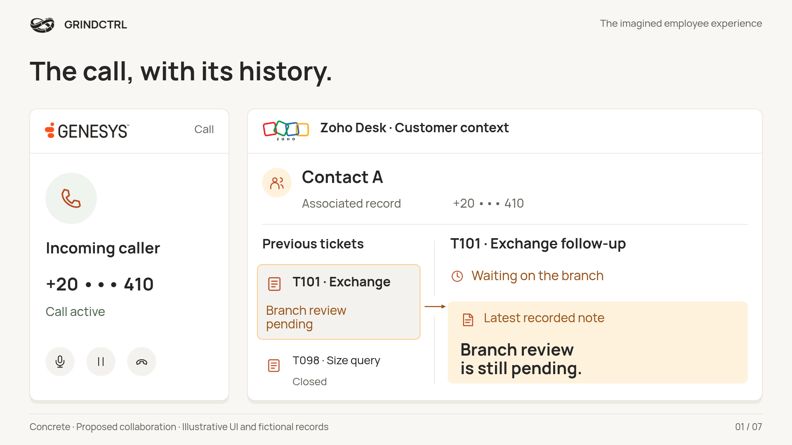
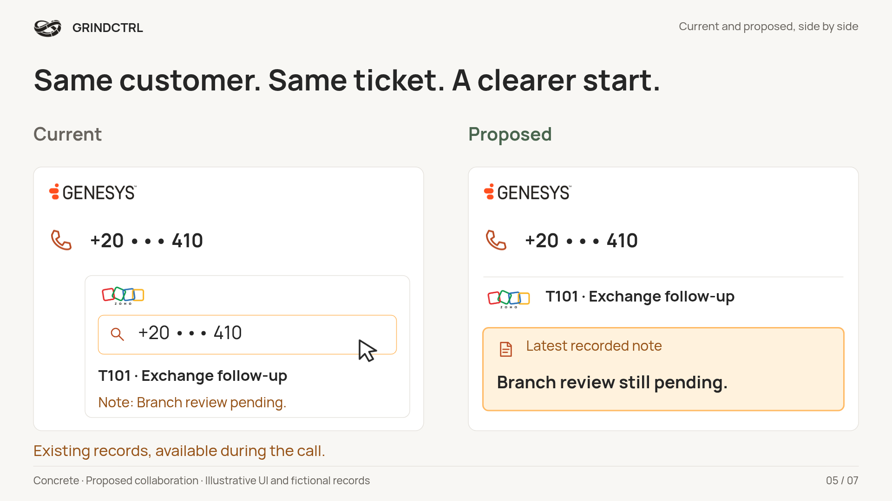

# GRINDCTRL × Concrete — Narrated product demonstration

A new light-theme demonstration: seven narration-led chapters, English/Arabic visuals and the original continuous Arabic recording. This is an illustrative new collaboration proposal, not a live integration or Concrete screenshot.

[Download the complete package](https://github.com/mhhmod/grindctrl_booking/raw/refs/heads/grindctrl-narrated-presentation-2026-10-11/GRINDCTRL-Concrete-Narrated-Package.zip)

## Open the presentation

- [Narrated interactive HTML](https://github.com/mhhmod/grindctrl_booking/raw/refs/heads/grindctrl-narrated-presentation-2026-10-11/grindctrl-narrated-presentation.html) — download and open in a modern browser. Audio, artwork and fonts are embedded. No server or login is required. This downloads a file; it is not a hosted player URL.
- [1080p video — English visuals](https://github.com/mhhmod/grindctrl_booking/raw/refs/heads/grindctrl-narrated-presentation-2026-10-11/grindctrl-narrated-en.mp4)
- [1080p video — Arabic visuals](https://github.com/mhhmod/grindctrl_booking/raw/refs/heads/grindctrl-narrated-presentation-2026-10-11/grindctrl-narrated-ar.mp4)

Both videos use the same original Arabic voice-over, about 2 minutes 17 seconds. HTML supports Play/Pause, Replay, seeking, chapter jumps, phrase stepping, language switching, optional Arabic captions and reduced motion. On a phone, Enlarge scene enables panning a readable workspace.

| Editable / static | English | Arabic |
|---|---|---|
| PowerPoint | [PPTX](https://github.com/mhhmod/grindctrl_booking/raw/refs/heads/grindctrl-narrated-presentation-2026-10-11/grindctrl-narrated-en.pptx) | [PPTX](https://github.com/mhhmod/grindctrl_booking/raw/refs/heads/grindctrl-narrated-presentation-2026-10-11/grindctrl-narrated-ar.pptx) |
| Reference PDF | [PDF](https://github.com/mhhmod/grindctrl_booking/raw/refs/heads/grindctrl-narrated-presentation-2026-10-11/grindctrl-narrated-en.pdf) | [PDF](https://github.com/mhhmod/grindctrl_booking/raw/refs/heads/grindctrl-narrated-presentation-2026-10-11/grindctrl-narrated-ar.pdf) |

PowerPoint and PDF have seven main scenes plus a shared-number appendix. PowerPoints contain native editable text/shapes, timed entrances and the original MP3. Microsoft PowerPoint audiovisual playback is unverified; HTML and MP4 are the verified synchronized masters. Native fonts and build source are in the ZIP.

## Timing and handoff

- [Cue sheet CSV](timeline.csv) / [JSON](timeline.json): 47 measured phrase intervals and two finer ASR cues; raw recognition retained.
- [Timing method](NARRATION-TIMING.md): phrase-level, reference-assisted spelling and estimated uncertainty; not certified word-level transcription.
- [QA report](QA-REPORT.md): playback/seek checks, complete media decoding, sampled zero audio lag, rendered-scene inspection and limits. No human full listen-through or external user study is claimed.
- [UI-fidelity handoff](UI-FIDELITY.md) / [disabled manifest](ui-fidelity-manifest.json): screenshot regions and cue-state hooks for later authorized anonymized Concrete captures.
- [PowerPoint notes](POWERPOINT-NOTES.md), [design evidence](DESIGN-AND-RESEARCH.md), [build source](source/README.md).

All sample records are fictional. Caller-number association is not authentication. Inspect the 2023 contracted “CRM URL pop up integration” before choosing an implementation; its current operation is unverified. Benefits are pilot expectations. No measured savings, AI requirement, refunds or ticket mutations are claimed.

العرض اتبنى من جديد على توقيت التسجيل الأصلي، مش إضافة صوت للعرض القديم. نزّل HTML وافتحه في المتصفح، أو شغّل الفيديو بعد تنزيله. الواجهات توضيحية لحد ما تتوفر صور مصرح بها ومنزوعة بيانات العملاء من الأنظمة الفعلية.
