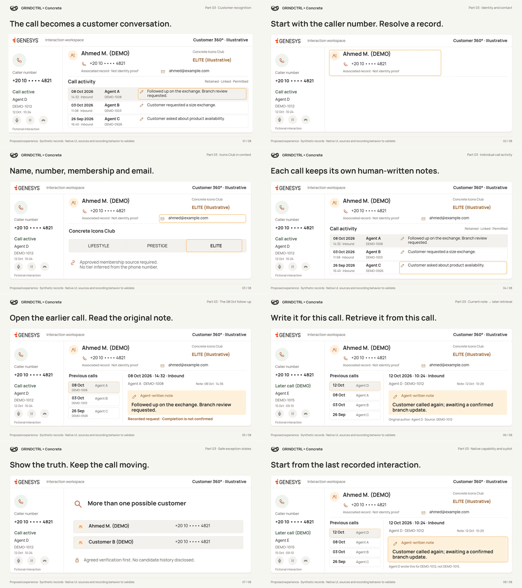

# GRINDCTRL × Concrete — Part 03: Customer 360° call experience

**Complete narrated film · 4:46 · Full HD 1920×1080 · 30 fps · Final original Arabic voice.**

- [Download the primary MP4](GRINDCTRL_Concrete_Part03_Customer360.mp4) — English UI, final Arabic narration.
- [Arabic visual MP4](GRINDCTRL_Concrete_Part03_Customer360_AR.mp4) — same unchanged recording.
- [Synchronized HTML](GRINDCTRL_Concrete_Part03_Customer360.html) — download and open in a browser. Self-contained audio/fonts/assets; play, pause, replay, mute, seek, scene jumps, visual language switching, captions and reduced motion. “Try call cases” opens the offline note/call simulation.
- [Complete production package](GRINDCTRL_Concrete_Part03_Customer360_Complete.zip).
- Static editable PowerPoint: [English](GRINDCTRL_Concrete_Part03_Customer360_en.pptx) / [Arabic](GRINDCTRL_Concrete_Part03_Customer360_ar.pptx).
- Static PDF: [English](GRINDCTRL_Concrete_Part03_Customer360_en.pdf) / [Arabic](GRINDCTRL_Concrete_Part03_Customer360_ar.pdf).
- [Actual narration/animation timeline](part03-cue-timeline.json), [speech CSV](part03-cue-timeline.csv), [animation CSV](part03-animation-events.csv).
- [Arabic SRT](part03-narration-ar.srt) / [normalized transcript](NARRATION_TRANSCRIPT_AR.md) — ASR-assisted, not certified verbatim; human subtitle review remains recommended.
- [Evidence matrix](EVIDENCE_MATRIX.md), [UI fidelity](UI_FIDELITY_REPORT.md), [QA](QA_REPORT.md), [source/rebuild instructions](source/README.md).

The employee sees a caller number, a permitted associated name, Icons Club tier, optional email and individual-call history with each call’s own human note. Agent D records a new note for DEMO-1012. A later DEMO-1015 call handled by Agent E reads that original note with its original source, author and timestamp; it does not become a future-call or customer-global note.

All profiles, membership, calls, dates and notes are synthetic and labeled. Concrete’s actual UI, sources, note storage, role grants and retention were not inspected. Native note-save behavior and any integration requirement remain to validate in authorized configuration review and pilot calls. No live connector, automatic Zoho synchronization, AI-generated note, call recording, measured savings or completed GRINDCTRL deployment is claimed.

Both movies fully decoded and played unmuted through the ending. Audio drift checks at eleven checkpoints found zero best-lag drift; 84 encoded frames were checked against HTML states. Seven offline scenario groups and 133 audio/visual seek destinations were checked. Precise methods and limitations are in QA; no human full listen-through or participant study is claimed.

HTML/MP4 are the synchronized masters. PPTX/PDF are twelve-page static references: eight main scenes plus complementary note-entry/exception states. PowerPoint contains editable native shapes/text and the original MP3; Microsoft PowerPoint audiovisual behavior is unverified. Install the bundled OFL fonts before editing.

This is a separate artifact branch, not a website deployment. The application checkout’s existing user changes were preserved.
